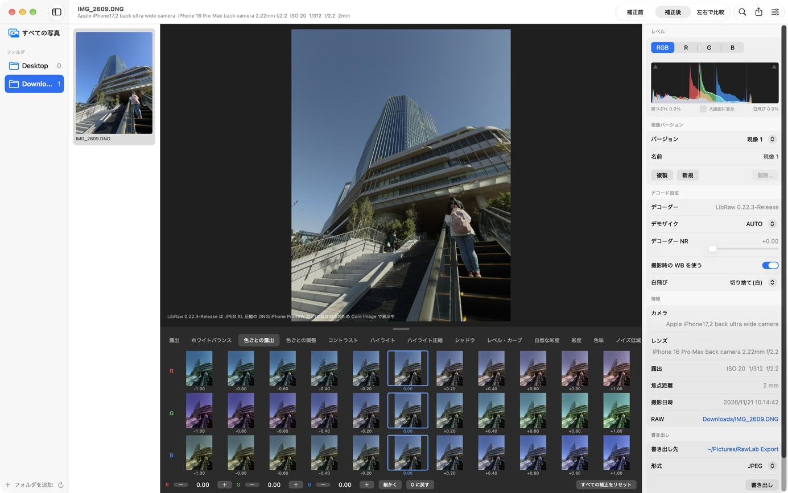

# RawLab

[日本語](README.md) | English

A personal RAW developer for macOS. You can switch between several RAW decoders and compare their results side by side.



## Download

Get the notarized app from [Releases](https://github.com/kamemamo/rawlab/releases) (`RawLab-<version>.zip`). Unzip it and drag `RawLab.app` into Applications.
Requires an Apple silicon Mac and macOS 27 or later. The bundled manual (PDF) is in Japanese.

## Requirements (building from source)
- Xcode / Swift 6
- `brew install libraw`
- Rust (for rawler). The first time, run `cd rawler-ffi && cargo build --release`

## Supported RAW formats

| Maker | Extensions | Tested cameras (samples from raw.pixls.us) |
|---|---|---|
| Nikon | NEF / NRW | D5 |
| Canon | CR3 / CR2 / CRW | EOS R5 (CRAW), EOS 5D Mark IV |
| Sony | ARW / SRF / SR2 | α7 III (uncompressed 14-bit) |
| OM System / Olympus | ORF | E-M1 Mark II |
| Fujifilm | RAF | X-T3 (X-Trans) |
| Panasonic / Leica | RW2 / RAW / RWL | LUMIX S5 |
| Pentax / Ricoh | PEF / PTX | K-1 |
| Samsung | SRW | NX1 (not supported by Core Image; opens with LibRaw / rawler) |
| Leica and others | DNG | M10 |
| Hasselblad / Phase One / Sigma / Minolta / Kodak, etc. | 3FR / FFF / IIQ / MOS / MEF / X3F / MRW / DCR / KDC / ERF | Untested (supported by the decoders) |

If a decoder can't open a file, RawLab automatically falls back to the next one.

## Library

- **RAW files**: RawLab only reads the folders you add (including subfolders). It never moves, changes or writes to RAW files
- **Edits**: stored together in `~/Pictures/RawLab Library/catalog.sqlite`. One RAW can have several develop versions
- **Export**: `~/Pictures/RawLab Export/<year>/<capture date>/<capture date-time>_<RAW name>[_<version name>].jpg` (the destination can be changed). Exports are recorded, and editing a photo after export marks it as "needs re-export"
- If you move or rename RAW files, add the new folder and rescan: RawLab matches photos by fingerprint (file size + SHA-256 of the first 1 MB) and keeps their edits
- Old-style sidecars (`<RAW>.rawlab.json`) are imported the first time a folder is added (the files are left in place)
- The `RAWLAB_LIBRARY` environment variable changes the library location (for testing)

## Usage

```sh
# App (build the .app and launch it). Pass folders with --args to add them to the library
./scripts/make-app.sh && open build/RawLab.app

# During development you can also use
swift run RawLabApp samples

# CLI
swift run rawlab decoders
swift run rawlab info samples/D5_sample.NEF
swift run rawlab develop samples/*.NEF --decoder libraw --ev 0.3 --out out
swift run rawlab compare samples/D5_sample.NEF --crop 800 --nr 0.5

# Library
swift run rawlab library add /Volumes/Photo/2026
swift run rawlab library photos
swift run rawlab library export /Volumes/Photo/2026/DSC_0001.NEF
```

## Distribution (Developer ID signing + notarization)

```sh
# Once: store notarization credentials in the keychain (use an app-specific password)
xcrun notarytool store-credentials rawlab-notary --apple-id <Apple ID> --team-id <Team ID>

# Build the distribution zip → build/dist/RawLab-<version>.zip
VERSION=0.1.0 ./scripts/make-dist.sh
```

- Bundles the Homebrew libraries (LibRaw, libomp, jpeg-turbo, lcms2) into the app and rewrites their load paths
- Puts license notices in `Contents/Resources/Licenses/` (regenerate the list with `./scripts/make-notices.sh`)
- Signs with Hardened Runtime → notarizes → staples → zips together with the read-me (`docs/はじめにお読みください.txt`) and the manual
- Runs on Apple silicon with macOS 27 or later (to match Homebrew's LibRaw build)
- The manual's screenshots and PDF are not in the repository; `docs/manual/manual.html` builds the PDF only when `docs/manual/img/` is present locally

## Layout
| Path | Role |
|---|---|
| `Sources/DecoderKit/RawDecoder.swift` | Common decoder contract (returns a linear, demosaiced CIImage) |
| `Sources/DecoderKit/CoreImageDecoder.swift` | macOS's built-in CIRAWFilter |
| `Sources/DecoderKit/LibRawDecoder.swift` | LibRaw C API |
| `Sources/DecoderKit/RawlerDecoder.swift` + `rawler-ffi/` | Rust's rawler (via a C ABI, fixed PPG demosaic) |
| `Sources/DecoderKit/RawLabEngineDecoder.swift` | RawLab's own engine. LibRaw only reads the mosaic data, black/white levels, WB and color matrix; black-level subtraction → WB → demosaic (Malvar-He-Cutler / bilinear / superpixel at half size) → color conversion are done in-house. Bayer only (no X-Trans) |
| `Sources/DecoderKit/ColorAdjust.swift` | Per-color adjustments (8 ranges × hue, saturation, lightness). Computed in OKLCH and applied in one pass as a 32³ 3D LUT. Protects low-saturation areas |
| `Sources/DecoderKit/HighlightReconstruction.swift` | Highlight reconstruction. Estimates clipped channels from unclipped ones and from surrounding hues spread by push-pull, keeping tones brighter than white. Used together with highlight roll-off (`DevelopSettings.highlightRolloff`) |
| `Sources/DecoderKit/LookMatch.swift` + `LookStore.swift` | Look matching to a reference image (Oklab lightness CDF + per-zone color transform → 33³ LUT). Ported from ZR Grade (red-zr) by the same author |
| `Sources/DecoderKit/DecoderRegistry.swift` | Decoder list and fallback |
| `Sources/DecoderKit/DevelopPipeline.swift` | Shared develop pipeline, export and thumbnails |
| `Sources/DecoderKit/Sidecar.swift` | Old-style sidecars (import only) |
| `Sources/LibraryKit/` | Catalog (SQLite), folder scanning, fingerprint matching, versions, export history |
| `Sources/rawlab-cli` | CLI |
| `Sources/RawLabApp` | SwiftUI app |

To add a decoder, implement `RawDecoder` and add it to `DecoderRegistry.all`.

## License

RawLab's code is under the [MIT License](LICENSE).
For the libraries it bundles or links (LibRaw and rawler are LGPL-2.1, among others), see [THIRD_PARTY_NOTICES.md](THIRD_PARTY_NOTICES.md).
